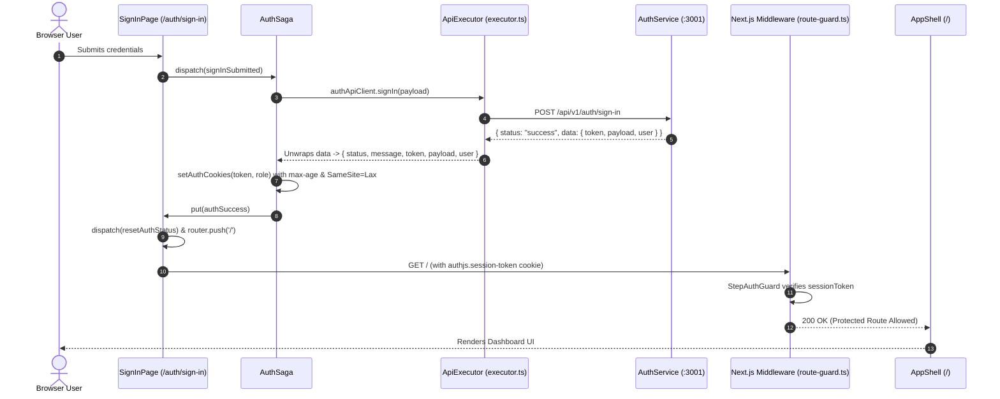

# ADR 0008: Session Cookie Persistence, Envelope Unwrapping, and Route Guard Redirect Loop Resolution

| Field | Value |
| --- | --- |
| **ADR ID** | `ADR-NODE-WEB-APP-0008` |
| **Title** | Session Cookie Persistence, Envelope Unwrapping, and Route Guard Redirect Loop Resolution |
| **Status** | **Accepted** |
| **Date** | 2026-09-06 |
| **Scope** | Web App Client & Edge Middleware (`packages/node/web-app`), Shared Infra Route Guards (`@observability/shared-infra/http`) |

---

## 1. Context & Problem Statement

Users accessing the web application experienced an infinite, high-frequency (~100ms) redirect loop alternating continuously between `GET / 200` and `GET /auth/sign-in?callbackUrl=%2F 200`.

A comprehensive root-cause analysis identified three compounding architectural defects across the request execution, cookie lifecycle, and route guard layers:

1. **Envelope Unwrapping Defect in API Executor (`web-app/src/lib/api/executor.ts`)**:
   - The backend `auth-service` returns standard REST responses wrapped in an API envelope:
     ```json
     {
       "status": "success",
       "message": "User signed in successfully",
       "data": {
         "token": "<JWT_STRING>",
         "payload": { ... },
         "user": { ... }
       },
       "error": null
     }
     ```
   - The frontend `executeHttpRequest` function returned the raw `json` object directly as `T`.
   - In `auth.saga.ts`, `response.token` was evaluated directly against `response`. Because the token was nested inside `response.data.token`, `response.token` was `undefined`.
   - As a result, `setAuthCookies(response.token)` was never invoked, and the session cookie was never written to `document.cookie`.

2. **Destructive Mount Behavior & Stale Redux State (`web-app/src/app/auth/sign-in/page.tsx`)**:
   - The `SignInPage` component executed an unconditional `useEffect` on mount that deleted `authjs.session-token` and `user_role` cookies.
   - When `authSuccess` was dispatched, `state.status` transitioned to `'success'`.
   - The navigation effect triggered `router.push(callbackUrl)` (`/`).
   - Upon landing on `/`, client-side `AppShell` checked for `authjs.session-token`. Finding no cookie, it redirected to `/auth/sign-in?callbackUrl=%2F`.
   - When `/auth/sign-in` mounted again, `state.status` was still `'success'`, triggering an immediate `router.push('/')` back to the root page, initiating an infinite ping-pong loop.

3. **Overly Broad Prefix Matching in Edge Route Guard (`shared-infra/src/http/middleware/route-guard.ts`)**:
   - `PUBLIC_ROUTES` defined `HTTP_CONSTANTS.ENDPOINT_ROOT` (`"/"`).
   - `isPublicRoute` checked `publicRoutes.some((route) => pathname.startsWith(route))`.
   - Because all URIs start with `"/"`, every route (including protected dashboards) was evaluated as public.
   - Server-side Next.js middleware could not issue early HTTP 307 redirects to unauthenticated requests, deferring protection entirely to client-side components.

---

## 2. Decision & Implementation Details



### 2.1 Standard API Envelope Unwrapping (`executor.ts`)
Updated `executeHttpRequest` to inspect the response payload for `json.data`:
- If `json.data` is an object, merges `{ status: json.status, message: json.message, ...json.data }` to provide top-level access to domain fields (`token`, `user`, `payload`) while retaining response status metadata.
- If `json.data` is an array (e.g. lists of users, organizations, keys), returns `json.data` directly.
- Preserves explicit error throwing when `json.status === "error"` or `json.error` is present.

### 2.2 Persistent Cookie Policy (`auth.saga.ts`)
Hardened cookie attributes in `setAuthCookies`:
- Configured explicit `max-age=604800` (7 days) and `SameSite=Lax` on `authjs.session-token` and `user_role` cookies.
- Prevents session loss across reloads and tab closures while defending against CSRF vulnerabilities.

### 2.3 Idempotent Client Auth Lifecycle (`SignInPage`)
Refactored `SignInPage`:
- Removed unconditional cookie deletion on mount.
- Added client cookie inspection on mount: if a valid session token exists, redirects immediately to `callbackUrl`.
- Dispatches `authActions.resetAuthStatus()` immediately upon successful sign-in navigation to prevent stale `'success'` states from triggering recurring navigations.

### 2.4 Precise Route Matching in Edge Middleware (`route-guard.ts`)
Refactored public route verification:
- Removed `ENDPOINT_ROOT` from `PUBLIC_ROUTES` (only explicit auth endpoints `/auth/sign-in`, `/auth/sign-up`, `/auth/callback` are public).
- Updated route matching so root route evaluations check exact equality (`pathname === "/"`) rather than prefix matching.
- Unauthenticated requests to `/` or protected paths now receive an instantaneous `HTTP 307 Temporary Redirect` directly from Next.js middleware, preventing unauthenticated page hydration and client-side loops.

---

## 3. Consequences & Verification

### Positive Consequences
- Completely eliminates the 100ms infinite redirect loop.
- Unauthenticated traffic is stopped at the edge/middleware boundary via HTTP 307 redirects without unnecessary component rendering.
- Session tokens are reliably stored and read from browser cookies.
- DTO contracts across all API client methods remain consistent with backend response shapes.

### Verification Results
1. **Unauthenticated Access**:
   `curl -i -s http://localhost:31400/`
   Returns `HTTP/1.1 307 Temporary Redirect` with `Location: /auth/sign-in?callbackUrl=%2F`.

2. **Authenticated Access**:
   `curl -i -s http://localhost:31400/ -H "Cookie: authjs.session-token=<VALID_TOKEN>; user_role=admin"`
   Returns `HTTP 200 OK` and cleanly renders the dashboard.

3. **Web App Stability**:
   Container logs confirmed that after sign-in, the application renders `/` without repetitive redirect log output.
