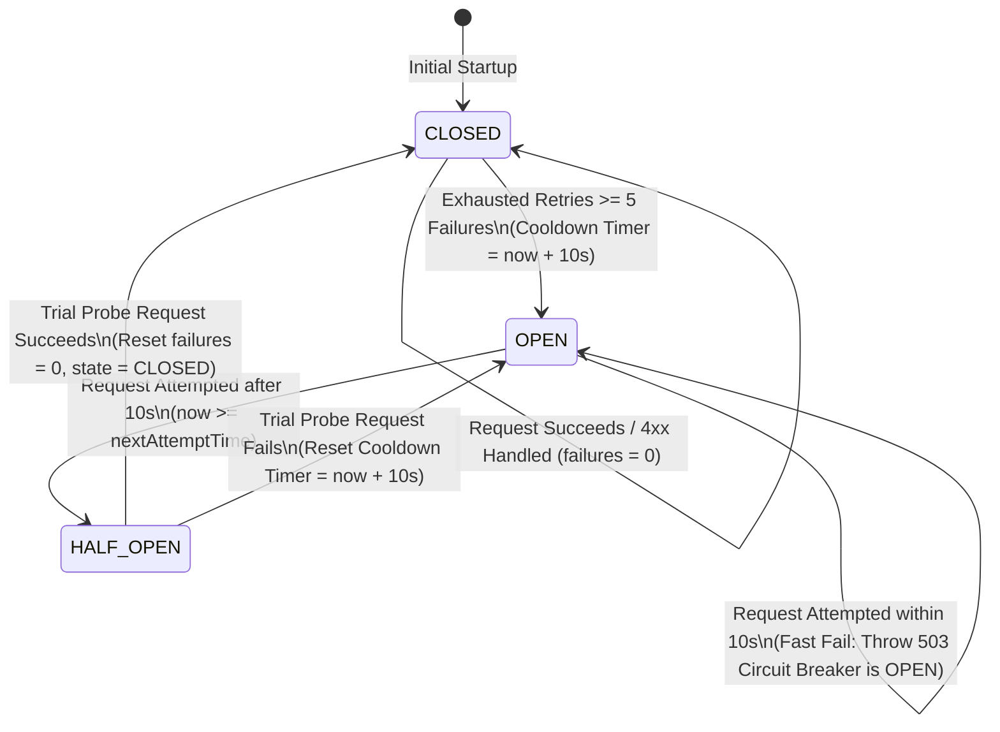
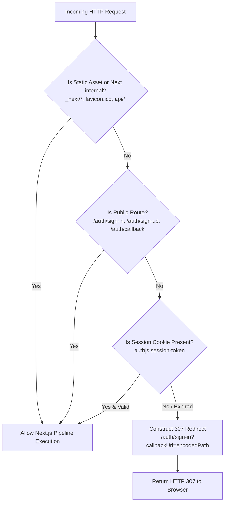
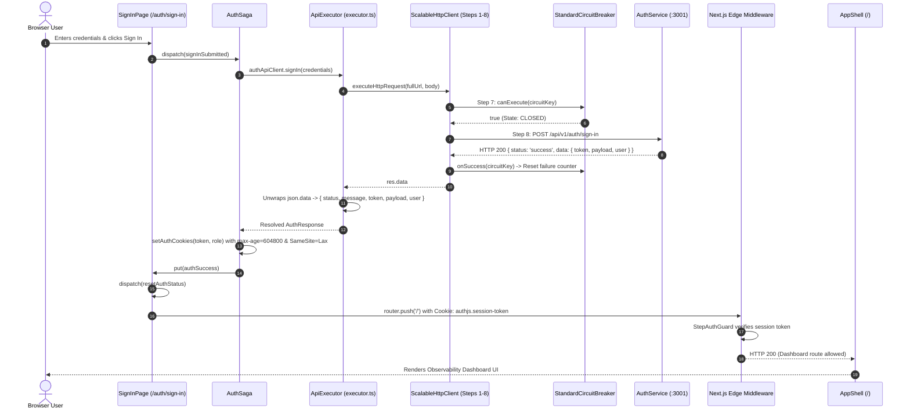

# ADR 0008: Session Cookie Persistence, Envelope Unwrapping, Circuit Breaker Cooldown, and Route Guard Redirect Loop Resolution

| Field | Value |
| --- | --- |
| **ADR ID** | `ADR-NODE-WEB-APP-0008` |
| **Title** | Session Cookie Persistence, Envelope Unwrapping, Circuit Breaker Cooldown, and Route Guard Redirect Loop Resolution |
| **Status** | **Accepted** |
| **Date** | 2026-09-06 |
| **Scope** | Web App Client & Edge Middleware (`packages/node/web-app`), Shared Infra Resilient Pipeline (`@observability/shared-infra/http`) |

---

## 1. Context & Problem Statement

Users accessing the web application experienced an infinite, high-frequency (~100ms) redirect loop alternating continuously between `GET / 200` and `GET /auth/sign-in?callbackUrl=%2F 200`. Concurrently, subsequent API calls (such as `listOrganizations`) triggered fast-fail circuit breaker errors:
```
Step - 7 - [CircuitBreaker] - Bounded LRU Circuit Breaker State Verification - [FAILED]
Error: Circuit breaker is OPEN for key ...
```

A root-cause analysis identified four compounding architectural defects across the request execution, circuit breaker state machine, cookie lifecycle, and route guard layers:

1. **Envelope Unwrapping Defect in API Executor (`web-app/src/lib/api/executor.ts`)**:
   - The backend `auth-service` returns standard REST responses wrapped in an API envelope:
     ```json
     {
       "status": "success",
       "message": "User signed in successfully",
       "data": {
         "token": "<JWT_STRING>",
         "payload": { ... },
         "user": { ... }
       },
       "error": null
     }
     ```
   - The frontend `executeHttpRequest` function returned the raw `json` object directly as `T`.
   - In `auth.saga.ts`, `response.token` was evaluated directly against `response`. Because the token was nested inside `response.data.token`, `response.token` was `undefined`.
   - As a result, `setAuthCookies(response.token)` was never invoked, and the session cookie was never written to `document.cookie`.

2. **Destructive Mount Behavior & Stale Redux State (`web-app/src/app/auth/sign-in/page.tsx`)**:
   - The `SignInPage` component executed an unconditional `useEffect` on mount that deleted `authjs.session-token` and `user_role` cookies.
   - When `authSuccess` was dispatched, `state.status` transitioned to `'success'`.
   - The navigation effect triggered `router.push(callbackUrl)` (`/`).
   - Upon landing on `/`, client-side `AppShell` checked for `authjs.session-token`. Finding no cookie, it redirected to `/auth/sign-in?callbackUrl=%2F`.
   - When `/auth/sign-in` mounted again, `state.status` was still `'success'`, triggering an immediate `router.push('/')` back to the root page, initiating an infinite ping-pong loop.

3. **Overly Broad Prefix Matching in Edge Route Guard (`shared-infra/src/http/middleware/route-guard.ts`)**:
   - `PUBLIC_ROUTES` defined `HTTP_CONSTANTS.ENDPOINT_ROOT` (`"/"`).
   - `isPublicRoute` checked `publicRoutes.some((route) => pathname.startsWith(route))`.
   - Because all URIs start with `"/"`, every route (including protected dashboards) was evaluated as public.
   - Server-side Next.js middleware could not issue early HTTP 307 redirects to unauthenticated requests, deferring protection entirely to client-side components.

4. **Excessive Cooldown & Per-Attempt Failure Counting in Circuit Breaker (`shared-infra`)**:
   - In `StandardCircuitBreaker`, the default cooldown was set to `cooldownMs = 3600000` (1 hour). Once tripped by transient startup failures or invalid credentials, the circuit was locked `OPEN` for an entire hour.
   - In `StepNetworkExecution`, `onFailure` was invoked inside the retry loop on every individual attempt rather than only after all retry attempts were exhausted, causing a single failing call with 3 retries to consume 60% of the failure threshold.

---

## 2. High-Level Design (HLD)

### 2.1 System Architecture & Pipeline Topology

```mermaid
flowchart TB
    subgraph ClientBrowser["Client Browser Environment"]
        User["Browser User / Agent"]
        CookieJar[("Browser Cookies\nauthjs.session-token\nuser_role")]
        SignInUI["SignInPage (/auth/sign-in)"]
        AppShellUI["AppShell & Layout (/)"]
        ReduxStore["Redux Store & Sagas\n(auth.slice & auth.saga)"]
        ClientExecutor["ApiExecutor (executor.ts)\nUnwraps { data: ... }"]
    end

    subgraph EdgeMiddlewareLayer["Next.js Edge Middleware Boundary (:31400)"]
        Middleware["NextRequest Middleware"]
        StepTracing["Step 1: OpenTelemetry SERVER Span"]
        StepCorrelation["Step 2: Request & Correlation ID"]
        StepAuthGuard["Step 3: StepAuthGuard & isPublicRoute"]
        RedirectEngine["HTTP 307 Redirect Engine"]
    end

    subgraph SharedInfraHTTP["Shared Infra Resilient HTTP Client Pipeline"]
        Admission["1. Concurrency Admission"]
        ContextIso["2. Context Isolation"]
        SSRF["3. SSRF & IP Validation"]
        RateLimiter["4. Tenant Rate Limiter"]
        Singleflight["5. Singleflight Deduplication"]
        CacheStore["6. Partitioned Cache Store"]
        CircuitBreakerEngine["7. StandardCircuitBreaker (10s Cooldown)"]
        NetworkExec["8. Network Socket Fetch & Retry"]
    end

    subgraph BackendServices["Backend Infrastructure"]
        Discovery["Service Registry (:31426)"]
        AuthBackend["Auth Service (:3001)"]
        AlloyDB[("AlloyDB Omni (:31412)")]
    end

    User -->|Navigate /| Middleware
    Middleware --> StepTracing --> StepCorrelation --> StepAuthGuard
    StepAuthGuard -->|No Cookie & Protected| RedirectEngine -->|307 Redirect| SignInUI
    StepAuthGuard -->|Cookie Present| AppShellUI

    User -->|Submit Credentials| SignInUI
    SignInUI --> ReduxStore
    ReduxStore --> ClientExecutor
    ClientExecutor --> Admission --> ContextIso --> SSRF --> RateLimiter --> Singleflight --> CacheStore --> CircuitBreakerEngine --> NetworkExec
    NetworkExec -->|Resolve Service| Discovery
    NetworkExec -->|POST /api/v1/auth/sign-in| AuthBackend
    AuthBackend --> AlloyDB
    AuthBackend -->> NetworkExec: { status: 'success', data: { token, user } }
    NetworkExec -->> ClientExecutor: Raw Response
    ClientExecutor -->> ReduxStore: Unwrapped { status, message, token, user }
    ReduxStore -->|setAuthCookies| CookieJar
    ReduxStore -->|authSuccess| SignInUI
    SignInUI -->|router.push('/')| Middleware
```

---

## 3. Low-Level Design (LLD)

### 3.1 LLD: Circuit Breaker State Machine & Cooldown Recovery



### 3.2 LLD: Edge Route Guard & Authentication Flowchart



### 3.3 LLD: Authentication & Cookie Lifecycle Sequence



---

## 4. Implementation Details

### 4.1 Standard API Envelope Unwrapping (`executor.ts`)
Updated `executeHttpRequest` to inspect the response payload for `json.data`:
- If `json.data` is an object, merges `{ status: json.status, message: json.message, ...json.data }` to provide top-level access to domain fields (`token`, `user`, `payload`) while retaining response status metadata.
- If `json.data` is an array (e.g. lists of users, organizations, keys), returns `json.data` directly.
- Preserves explicit error throwing when `json.status === "error"` or `json.error` is present.

### 4.2 StandardCircuitBreaker Cooldown & Failure Isolation (`shared-infra`)
- Reduced default `cooldownMs` in `StandardCircuitBreaker` from `3600000` (1 hour) to `10000` (10 seconds), matching the decorator standard and preventing prolonged lockout after service recovery.
- Added `reset(circuitKey?: string)` method on `StandardCircuitBreaker` and `ScalableHttpClient`.
- In `StepNetworkExecution`, updated failure tracking to only call `onFailure` when `attempt === maxAttempts` (all retries exhausted), avoiding false trips on retryable transient network blips.

### 4.3 Persistent Cookie Policy (`auth.saga.ts`)
Hardened cookie attributes in `setAuthCookies`:
- Configured explicit `max-age=604800` (7 days) and `SameSite=Lax` on `authjs.session-token` and `user_role` cookies.
- Prevents session loss across reloads and tab closures while defending against CSRF vulnerabilities.

### 4.4 Idempotent Client Auth Lifecycle (`SignInPage`)
Refactored `SignInPage`:
- Removed unconditional cookie deletion on mount.
- Added client cookie inspection on mount: if a valid session token exists, redirects immediately to `callbackUrl`.
- Dispatches `authActions.resetAuthStatus()` immediately upon successful sign-in navigation to prevent stale `'success'` states from triggering recurring navigations.

### 4.5 Precise Route Matching in Edge Middleware (`route-guard.ts`)
Refactored public route verification:
- Removed `ENDPOINT_ROOT` from `PUBLIC_ROUTES` (only explicit auth endpoints `/auth/sign-in`, `/auth/sign-up`, `/auth/callback` are public).
- Updated route matching so root route evaluations check exact equality (`pathname === "/"`) rather than prefix matching.
- Unauthenticated requests to `/` or protected paths now receive an instantaneous `HTTP 307 Temporary Redirect` directly from Next.js middleware, preventing unauthenticated page hydration and client-side loops.

---

## 5. Consequences & Verification

### Positive Consequences
- Completely eliminates the 100ms infinite redirect loop.
- The circuit breaker recovers in 10 seconds via half-open trial probes rather than locking the client out for an hour.
- Internal HTTP retry attempts do not inflate circuit breaker failure counts.
- Unauthenticated traffic is stopped at the edge/middleware boundary via HTTP 307 redirects without unnecessary component rendering.
- Session tokens are reliably stored and read from browser cookies.

### Verification Results
1. **Unauthenticated Edge Guard**:
   `curl -i -s http://localhost:31400/`
   Returns `HTTP/1.1 307 Temporary Redirect` with `Location: /auth/sign-in?callbackUrl=%2F`.

2. **Authenticated Access**:
   `curl -i -s http://localhost:31400/ -H "Cookie: authjs.session-token=<VALID_TOKEN>; user_role=admin"`
   Returns `HTTP 200 OK` and cleanly renders the dashboard.

3. **Circuit Breaker Recovery & Authorized API Verification**:
   `curl -i -s http://localhost:3001/api/v1/auth/organizations -H "Authorization: Bearer <VALID_TOKEN>"`
   Returns `HTTP 200 OK` with `{"status":"success","data":[{"id":"...","name":"Scaibu"}]}` without tripping the circuit breaker.
